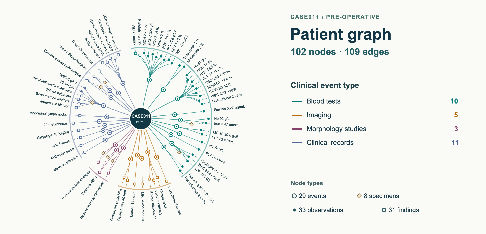
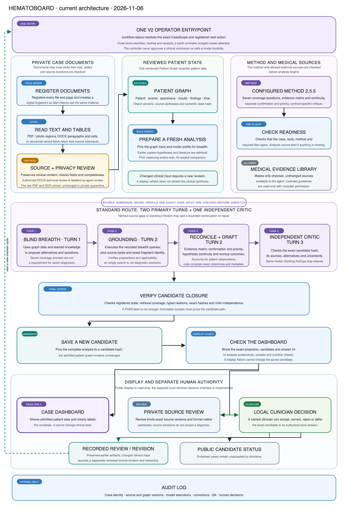
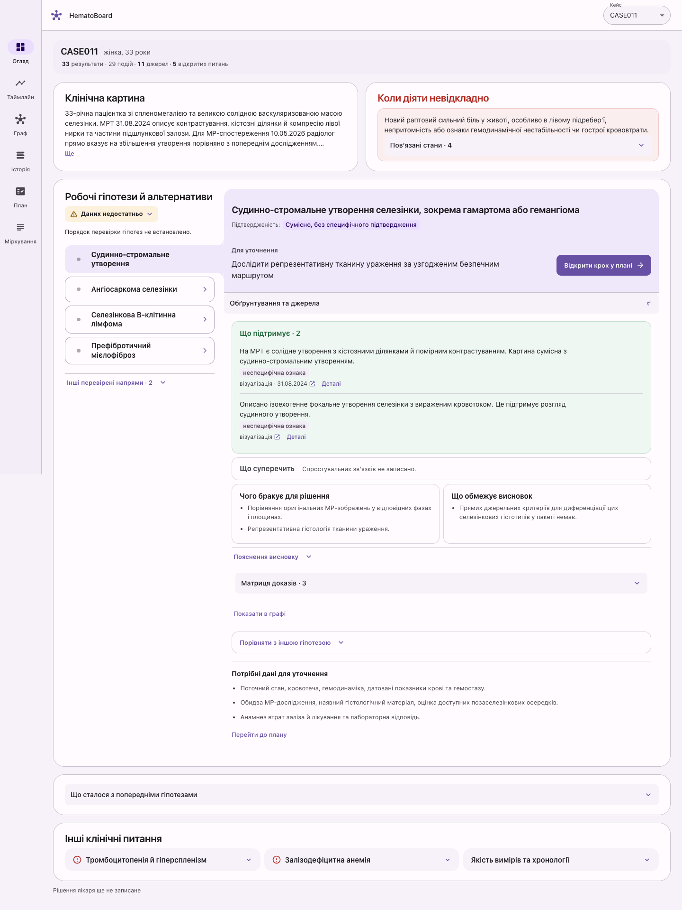
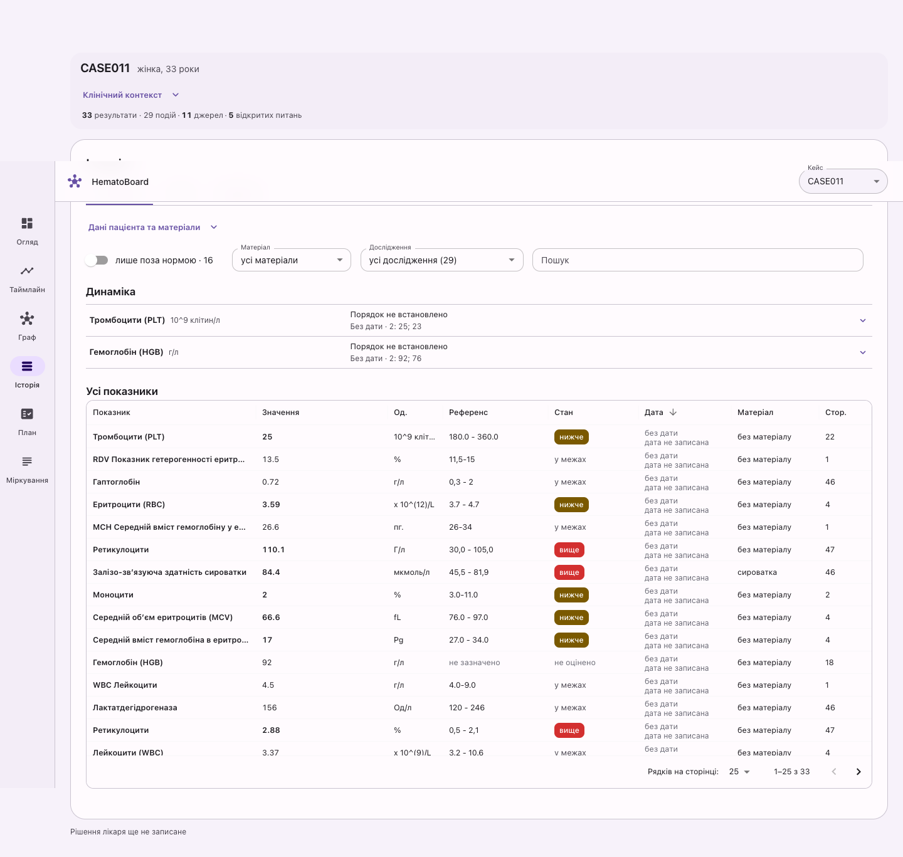
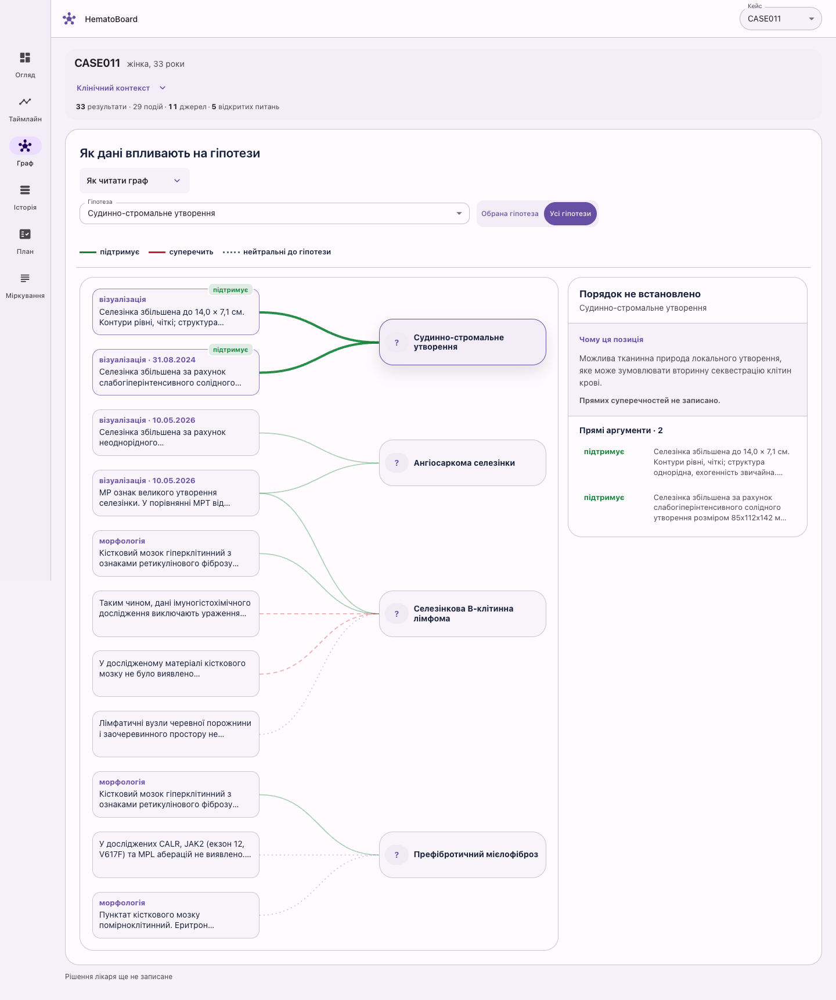
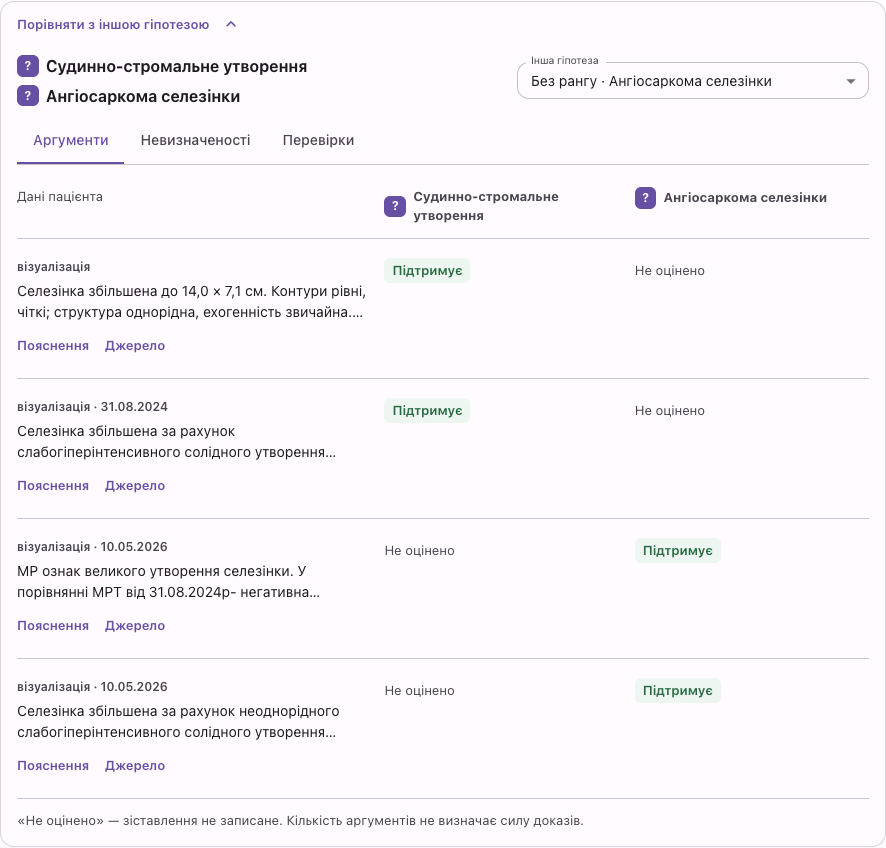

# HematoBoard

<!-- markdownlint-disable MD013 MD033 MD036 -->

## Agentic AI for Traceable Hematology Review

**System description updated 6 November 2026 · public interface 0.2.9.50 · current configured synthesis protocol 2.5.5**

[Open CASE011](https://esannikov.github.io/hematoboard/?case=case011)
· [open CASE027](https://esannikov.github.io/hematoboard/?case=case027)
· [inspect the architecture](./diagrams/hematoboard-trace-system.svg)
· [inspect the dated release manifest](./diagrams/manifest.json)

## System at a glance

**HematoBoard prepares complex clinical records for clinician review.** It reads
documents into a versioned patient graph, proposes possible explanations, checks
the medical sources needed to distinguish them, and submits a candidate to an
independent model execution for critique. The clinician receives hypotheses,
arguments, contradictions, missing information and proposed next checks, with
navigation to their sources. Deterministic code controls identities, versions,
permitted transitions and publication checks. A named clinician records the
decision on the candidate in a separate local review session.

| Architectural fact | Meaning |
| --- | --- |
| Input | Authorized PDF, photographs, DOCX or structured patient records. |
| Patient-state authority | The reviewed Patient Graph in the current graph-backed route. |
| Output | An immutable candidate and its read-only clinical presentation. |
| Model work | Source interpretation where required, hypothesis generation, source applicability, synthesis and independent critique. |
| Code work | Parsing/materialization, references, hashes, validators, execution accounting, recovery and projection. |
| Human authority | Source/privacy/display decisions as applicable, and a separately recorded clinician decision. |
| Public access | Published case review; document intake, model dispatch and decision writing belong to controlled local workflows. |

The research question is practical: **can a clinical team inspect what a system
used, what it inferred, what it failed to explain, and what would change its
conclusion?** The result is a candidate for review, not an automatically accepted
diagnosis. The system is being tested in clinical conditions as a research
workflow. External clinical validation, regulatory qualification and improved
patient outcomes have not been established.

This article describes the current implementation and a dated public release.
Historical cases retain their original synthesis contracts. The configured
protocol version above is not a retrospective label for every published run.

## Why a hematology record resists review

A difficult case spans institutions, laboratories, modalities and episodes of
care. A result needs its own unit, reference interval, specimen and clinical date;
reference intervals are distinct from clinical decision limits (Ozarda et al.,
2018). A later pathology report can change the interpretation of an earlier
image. Hematologic classifications integrate morphology, immunophenotype,
clinical context and molecular findings, with criteria that change between
editions (Alaggio et al., 2022; Campo et al., 2022).

Document transfer and interpretation can each fail. Laboratory errors occur in
pre- and post-analytical processes as well as analysis itself (Plebani, 2006).
Anchoring and premature closure can make a plausible initial explanation obscure
alternatives (Croskerry, 2003; National Academies of Sciences, Engineering, and
Medicine, 2015). Language models bring learned clinical knowledge (Singhal et al.,
2023) but can also generate unsupported statements (Ji et al., 2023).
HematoBoard therefore makes both the patient record and the proposed argument
inspectable. Faster summarization alone would not establish their correctness.

## Two graphs with different jobs

The **patient graph** represents the documented patient state. It connects a
patient to clinical events, specimens, observations, findings and, where recorded,
temporal relations. An event is a study, procedure, panel or clinical record;
a page is a source location, not automatically a separate event. Every clinical
object retains its source address, review status and version. Collection,
ordering, registration and report dates keep different roles. An unknown unit,
date or result remains unknown.

The **argument graph** represents a candidate interpretation. It links exact
versions of patient objects to hypotheses through supporting, refuting or neutral
relations, and connects literature propositions to their case-specific use.
A guideline can support a diagnostic rule or a proposed investigation; it cannot
establish that the patient has the required finding. Neither graph produces a
diagnostic probability from the number of nodes, edges or citations.

<p align="center">
  <a href="assets/patient-graph/CASE011-patient-graph.en.svg"></a>
  <br>
  <sub><strong>Figure 1. The recorded patient graph of CASE011.</strong> The English presentation preserves all 102 nodes: 1 patient + 29 events + 8 specimens + 33 observations + 31 findings, and all 109 structural edges. Colour groups events into blood tests, imaging, morphology and clinical records; shape distinguishes node types. The radial arrangement is a reading layout, not a time axis, causal model or map of diagnostic confidence. Labels and tooltips are translated; original clinical records remain unchanged. Question marks preserve unresolved source units, including implausible units printed in the source.</sub>
</p>

[Open English PNG](./assets/patient-graph/CASE011-patient-graph.en.png)
· [open English SVG](./assets/patient-graph/CASE011-patient-graph.en.svg)
· [original Ukrainian illustration](./assets/patient-graph/CASE011-patient-graph.svg)

## How the system is organized

The private workbench handles intake, recognition where needed, source review and
de-identification. A case-scoped controller advances explicit workflow steps.
In the current graph-backed route, the patient graph is the sole patient-state
input to reasoning. Source records, clinical facts and signals remain intake or
compatibility indexes; they are not supplied as a second, competing patient model.

The agent writes clinical content and explicit review findings. Code supplies
identifiers, hashes, source addresses, serialization and execution accounting.
The controller checks the contracts and records transitions; it does not choose
a diagnosis, argument strength or hypothesis rank. The host of the active dialogue
dispatches model work only when the workflow requests it.

<p align="center">
  <a href="diagrams/hematoboard-trace-system.svg"></a>
  <br>
  <sub><strong>Figure 2. Modules, responsibilities and data flow.</strong> Read the three numbered rows from left to right. Arrows show the principal handoffs; the module contracts specify the full inputs. Patient data and permitted medical sources enter through different paths. The reviewed graph supplies both blind hypothesis generation and the later synthesis. The dashed return marks one bounded clinical repair followed by fresh independent critique. Code supervises all handoffs. The standard synthesis route has two primary model turns and one critic turn; approved source continuations or repair can add work. The local clinician decision interface is implemented; the public dashboard cannot write a decision.</sub>
</p>

[Open the full-size architecture PNG](./diagrams/hematoboard-trace-system.png)
· [open scalable SVG](./diagrams/hematoboard-trace-system.svg)

<details>
<summary><strong>Module contracts: inputs, outputs and responsibilities</strong></summary>

<!-- BEGIN GENERATED MODULE CONTRACTS -->
| Module | Main actors | Input → result | Responsibility |
| --- | --- | --- | --- |
| **Original documents** | code, human | Authorized PDF, photographs, DOCX or structured records → Registered source files and page inventory | Private original source artifacts |
| **Source reading & review** | code, AI model, human | Registered documents and format-native locations → Structured source reading, field statuses and review records | Source reading revisions; review authority is explicit |
| **Patient graph** | code | Admitted source reading and clinical input → Versioned patient objects and structural/temporal relations | Canonical patient state for graph-backed reasoning |
| **Starting hypotheses** | AI model | Current patient graph; learned model knowledge → Breadth candidates, coverage review and questions | A stage result; no change to patient state |
| **Source search & review** | code, AI model | Breadth questions and permitted medical sources → Reviewed propositions, applicability and evidence gaps | Case-evidence artifacts; no patient-state mutation |
| **Candidate & argument graph** | AI model, code | Exact patient graph, breadth, reviewed evidence and permitted post-breadth history → Immutable candidate, typed arguments, evidence matrix and workup | Candidate interpretation; no clinician acceptance |
| **Independent critic** | AI model | Exact candidate and supporting patient/source bindings → Critic findings and a hash-bound review result | Review record; cannot edit the candidate reviewed |
| **Read-only dashboard** | code, human | Reviewed candidate, patient projection, QA and public-display permission → Version-bound public package, interface and permitted media | Derived presentation; no clinical-state writes |
| **Clinician decision** | human, code | Exact candidate/package and an authorized named reviewer → Accept, correct, reject or defer decision record | Recorded clinician decision; separate from technical review |
| **Workflow controller** | code | CaseScope, registered step, exact bindings and execution records → Allowed next action, request/receipt, validation or explicit stop | Workflow journal and case routing, not clinical conclusions |

Roles describe permitted responsibilities, not a requirement that every role acts in every format. Source reading uses its recorded human or explicitly delegated review route.
<!-- END GENERATED MODULE CONTRACTS -->

The module descriptions and diagram are generated from the same structured
architecture block in the [manifest](./diagrams/manifest.json). That block is a
dated description of the implementation, not an executable workflow or a new
source of clinical authority. It records inputs, outputs, responsibilities,
deployment locations, dependencies and evidence references for software readers.


</details>

### Where the parts run

| Location | What happens there | What leaves it |
| --- | --- | --- |
| Private case workspace | Raw document storage, recognition, source review, graph versions and run records. | Only the specifically authorized, minimum-necessary derived material. |
| Model execution context | The host supplies the packet for the current stage; author and critic executions have distinct recorded roles. | Typed results returned to the controller for validation. |
| Medical source library | Permitted source files, source identities and retrieval/render caches. | Allowed fragments and their bindings for a named review task. |
| Public dashboard | Read-only case packages, sources permitted for public display and prepared media. | Navigation and playback; no clinical-state writes or synthesis dispatch. |
| Local clinician review session | A named human reviews the exact candidate and records accept, correct, reject or defer. | An explicit, version-bound decision record. |

The workflow can use an external model, but raw patient documents are not thereby
authorized for external transfer. The actual model and reasoning effort are bound
to each new execution. A public diagram of a module does not mean that its write
operations are exposed on the public website.

### 1. Read and admit the source material

PDF, photographs, native DOCX and structured inputs use one source-reading
contract with format-specific addresses. PDF and image sources use page regions;
DOCX uses document parts, paragraphs or table cells; structured inputs use record
and field addresses. Apple Vision remains a local OCR component for applicable
image inputs (Apple, n.d.); native text does not need to be treated as a scan.
Recognition is a separate transfer problem whose accuracy depends on the document
and layout (Rasmussen et al., 2012).

Reading preserves literal values, units, comparators, reference intervals,
specimens, methods and time roles. Repeated source instances are retained while
study grouping is reviewed. Administrative headings become event context rather
than clinical findings. Identifier removal preserves clinical content and the
non-identifying parts of laboratory headers. Original documents stay private.

Field-level review distinguishes exact, corrected and unresolved readings.
Source inventory accounts explicitly for unassigned material. Checks catch known
forms of truncated statements, missing dimensions and omitted continuation text;
they are safeguards, not a proof that every possible extraction error is detected.
Reviewable revisions preserve the previous source version rather than rewriting it.

Human source and privacy review remain explicit. A separately authorized route
allows technical review of native DOCX with the actual agent execution recorded:
`human_verified` remains false. Technical source verification, permission for
external processing, permission for public display and clinician acceptance
must not be used as synonyms. Historical G1/G2/G4 receipts retain their original
meaning; they are not universal names for every current intake step.

The private intake offers more than text extraction:

| Reading task | Implemented handling |
| --- | --- |
| Scanned pages and ordered photographs | Local Apple Vision in accurate mode, requesting Ukrainian, Russian and English where supported by the installed engine; preserved page order and an explicit failed-page record. |
| Native documents | Direct DOCX paragraph/table extraction and native PDF text/layout where available. A text document is not needlessly treated as an OCR image. |
| Laboratory tables | Source geometry helps associate the analyte, result, unit, comparator and reference interval with a row; the assignments remain reviewable. |
| Inspect a doubtful character | The private review view can place the exact page/crop beside the extracted field, with word coordinates and source hashes. Corrections retain the original reading and a separate correction record. |
| Preserve context | Specimen, method, date roles, duplicate instances and links between a study and its results remain available to review. Unknown fields are not completed from a textbook. |
| Detect incomplete transfer | Page inventory, field-review flags and checks for known dangling statements or missing continuations stop unresolved material entering the corresponding reviewed route. |

OCR confidence describes the recognizer's output; it is not a probability that a
clinical value is correct. This article reports no validated OCR accuracy rate
and makes no general handwriting-recognition claim. These intake functions run
in the controlled workbench, not as an upload service on the public dashboard.

### 2. Form starting hypotheses from the patient graph

The first model turn receives the current patient graph without earlier system
hypotheses, ranks, workup plans or retrieved literature. The model proposes
possible explanations using the supplied findings and patterns learned during
training. That learned knowledge is not a retrieved, verified source citation.
Source-stated clinical suspicions remain identifiable as statements in the record.

Seven coverage questions encourage a broad differential:

| Direction | Question |
| --- | --- |
| Unifying explanation | What could explain the main pattern? |
| Close alternative | What neighbouring diagnosis could fit? |
| Different mechanism | What other mechanism could produce these findings? |
| Reversible or treatable cause | What might be correctable? |
| Must not miss | What dangerous possibility needs explicit consideration? |
| Second process | Could more than one process be present? |
| Data artifact | Could sampling, units or transcription explain a finding? |

These are coverage prompts, not a requirement for seven diagnoses. Each direction
needs consideration or an explicit reason it does not apply. The number of
supported hypotheses depends on the case. This separation reduces direct carry-over
from an earlier answer; it does not guarantee freedom from anchoring or model bias.

### 3. Ask targeted questions and verify the sources

Starting hypotheses generate two separate question sets: questions for medical
literature and questions about missing patient data. The agent can discover
candidate sources through PubMed, DOI records, professional societies,
classifications and permitted local corpora. Local retrieval binds queries to
source identity, version, rights and exact content. Applicable formal criteria
are selected after the initial differential, rather than dictating it in advance.

A title, PMID or search hit is a discovery result. To use a clinical proposition,
the author records what the source says, its location, evidence type, applicability
and limitations. Layout-dependent tables and figures require visual review of
the selected pages. A second visual reader is reserved for a named unresolved
ambiguity. Retrieval grounding supports inspectability but does not itself prove
that the interpretation is correct (Zakka et al., 2024).

An unrecognized retrieval topic, an unselected corpus domain or an empty result
is recorded as a search limitation; none establishes that relevant literature
does not exist or that a diagnosis is excluded. A named gap may trigger targeted
source expansion. General literature cannot supply a missing patient result.
Guideline editions and dates remain explicit (d’Amore et al., 2025); permissions
are tracked separately. Guideline quality
can also be appraised using established instruments such as AGREE II
(Brouwers et al., 2010).

### 4. Synthesize the evidence and expose uncertainty

The current synthesis contract adds several inspectable outputs:

| Output | What it lets the clinician inspect |
| --- | --- |
| **Evidence matrix** | A discriminating question, the patient's recorded state, relevant source propositions, missing information and the next check. |
| **Confirmation assessment** | Insufficient data, nonspecific compatibility, specific support or conflicting evidence, with reasons. |
| **Verification priority** | Why one hypothesis should be checked before another. Priority may remain unset; it is not a probability or diagnosis. |
| **Hypothesis continuity** | Which previous hypotheses were retained, refined, merged, not prioritized or no longer supported, and why. Not prioritized does not mean excluded. |
| **Observation accountability** | How observations and findings were considered, including data still unexplained or not separately assessed. |
| **Workup outcome branches** | How alternative results of a proposed test could affect the interpretation, including an indeterminate result. These are conditional assessments, not automatic changes to rank. |

Earlier hypotheses become available only after blind breadth, as prior reasoning
for comparison. They do not override current patient data. The source-bound
problem summary is a reading aid; it does not replace the complete graph.
The contract distinguishes a documented negative result from an unperformed test,
an unmentioned finding, an unmet criterion and uncertainty.

### 5. Critique, repair and verify the projection

An independent model execution reviews the exact candidate and its supporting
material. New executions use the model and reasoning effort of the active
dialogue; the critic's independence means a separate execution/context, not
necessarily a different model family. Shared model errors can therefore persist.

For candidate contract 1.4, the ordinary critique includes 27 required checks.
Alongside anchoring, unsupported links and omitted alternatives, it checks
question coverage, argument specificity, rank-change explanations, workup branches,
observation accounting, evidence-matrix fidelity, hypothesis continuity and the
separation of confirmation from priority. Older candidates retain the checks of
their own contracts.

A blocking finding permits one bounded clinical repair followed by independent
review. A second blocking critic failure stops the run. Exact low-severity wording
corrections explicitly reviewed by the critic can use the authorized scoped
correction route with separate coverage records. They cannot silently change
patient facts, ranks or relation directions. An unresolved material source defect
can place a published package on review hold.

The dashboard is generated from saved artifacts and checked separately.
Rendering errors do not authorize a new clinical conclusion. Public release
checks bind the case package, candidate, shared interface and browser evidence;
a technically successful release does not create a clinician decision.

## What the clinician sees and decides

The shared interface offers several ways to inspect one saved case. Older
packages show the content recorded under their own contracts; an unavailable
assessment is not generated merely to fill a panel.

| Clinical reading task | Where to look | What can be inspected |
| --- | --- | --- |
| Orient to the case | **Overview** | The clinical picture, conditional urgent concerns, concise hypotheses, confirmation, justified verification priority and the next clarification. |
| Follow a hypothesis to the record | **Hypothesis card and argument graph** | Supporting, refuting and neutral relations, their rationale and links to the patient records behind them. The default graph focuses on one hypothesis; the full view retains all recorded relations. |
| Compare two explanations | **Hypothesis comparison** | How the same patient finding bears on either explanation, what remains missing, and which recorded test-outcome scenarios could distinguish them. A missing comparison is explicitly labelled “not assessed”. |
| Review change over time | **Timeline and history** | Dated studies, quantitative results and available trends with source context. Ordering/report dates do not silently become collection dates. |
| Check the literature | **Source cards and evidence matrix** | The source title, edition/year, page or section, the proposition actually used, its application to the case and gaps in coverage. Public links are provided where available and permitted. |
| Follow the investigation | **Reasoning and decision audit** | Starting hypotheses, evidence decisions, alternatives retained or set aside, critic findings and recorded revisions. |
| Decide what to clarify next | **Plan** | The purpose and necessity of an investigation, the relevant triggers and conditions, missing information, and recorded possible outcomes. |
| Prepare for discussion | **Briefings, where available** | A source-bound audio/video presentation of the saved candidate; currently prepared for CASE027. |

### Reading the reasoning record

The **Reasoning** view combines a clinician-facing narrative with an expandable
decision audit. It follows the documented investigation: what was considered
initially, which questions led to source checking, which evidence was used or
not used and why, how the candidate developed, and what the critic challenged.
Entries can open the linked patient records or external-source cards. The audit
also exposes previous-hypothesis dispositions and recorded corrections where
the run contains them.

This is an explanation assembled from saved results, queries, source propositions
and review findings. It is not a verbatim transcript of a model's private internal
reasoning. Missing stages or source support must remain identifiable; readable
prose is not a substitute for the underlying records.

### Following a hypothesis to its evidence

Two complementary trails support inspection:

```text
Patient document → exact patient-object version → support / refute / neutral → hypothesis
Medical source   → verified source proposition  → case applicability       → matrix / workup
```

Selecting a patient-data node exposes the relevant record and the stored relation
rationale. The public source view shows the approved de-identified record; the
private workbench can show the original page/crop. Selecting an external-source
reference exposes its identity and the proposition used, subject to its access
rights. A literature reference is not routed as though it were a patient document.

**Source-linked does not mean confirmed.** A hypothesis may have patient-specific
support and literature informing its verification while still lacking direct
evidence for the diagnosis. The matrix distinguishes adequate, partial and missing
literature coverage. Citation counts and graph connectivity do not determine
evidence strength.

For example, the saved CASE011 candidate treats focality, blood flow and contrast
enhancement as compatible with a vascular lesion. Its recorded source proposition
uses the **National Comprehensive Cancer Network (NCCN) Clinical Practice
Guidelines in Oncology: Soft Tissue Sarcoma, Version 3.2026, page 75**, for
classification terminology. That use does not provide spleen-specific MRI
discrimination or a probability of a benign subtype. The candidate records partial literature coverage and missing
representative tissue. Its status therefore remains compatible, with no established
ordering among the diagnostic hypotheses. This example describes the
[published candidate](https://esannikov.github.io/hematoboard/?case=case011&view=overview&hypothesis=H1),
not a new clinical assessment.

<details>
<summary><strong>Current interface examples — CASE011, release 0.2.9.50</strong></summary>

<p><a href="assets/current-interface/case011-overview.png"></a><br><sub><strong>Figure 3. Overview.</strong> The selected hypothesis remains provisional. The full screenshot can be opened to inspect its arguments.</sub></p>

<p><a href="assets/current-interface/case011-history.png"></a><br><sub><strong>Figure 4. History.</strong> Clinical events and results keep their source context and date roles.</sub></p>

<p><a href="assets/current-interface/case011-argument-graph.png"></a><br><sub><strong>Figure 5. Argument graph.</strong> This is a hypothesis-specific argument view, distinct from the patient graph in Figure 1.</sub></p>

<p><a href="assets/current-interface/case011-comparison.png"></a><br><sub><strong>Figure 6. Hypothesis comparison.</strong> The recorded role of the same finding can be inspected for two competing explanations.</sub></p>

[Open the full Reasoning view capture](./assets/current-interface/case011-reasoning.png)
to inspect the saved narrative, decision audit and source-library presentation.

These are saved browser-QA captures bound to the published package and shared
interface. They show the Ukrainian clinical interface. The
[English CASE001 demonstration](https://esannikov.github.io/hematoboard-en/?case=case001)
is an earlier presentation and is not the current interface reference.

</details>

CASE027 also has an [audio and video briefing](https://esannikov.github.io/hematoboard/?case=case027&view=video).
They present an already saved candidate; they do not run a new clinical synthesis.
Their case, candidate and public-package hashes must match before playback is
offered. A changed package or review hold suppresses the old briefing. Media are
prepared supplements, not automatically available for every case.

The public dashboard cannot write a clinical decision. A separate, implemented
local review interface lets a named clinician **accept, correct, reject or defer**
the exact candidate. It uses the existing decision-recording route with session,
origin and request checks. It does not provide final-diagnosis or outcome entry.
All 20 packages in the dated public release still record
`clinician_accepted=false`; an available review interface is not evidence of a
completed review.

## Reproducibility and economical execution

Patient objects, source propositions, model executions and human actions have
distinct identities. Their recorded relationships follow the provenance logic of
entities, activities and agents (World Wide Web Consortium, 2013). Stable identity
and explicit versions also support research-data reuse (Wilkinson et al., 2016).

**Input identity.** A reasoning run binds the approved source input, the semantic
patient-graph state, exact object versions and the model-facing input. SHA-256
checks establish byte or canonical-content identity, not clinical truth (National
Institute of Standards and Technology, 2015). The graph state has its own semantic
hash; recording timestamps do not by themselves create a new clinical state.
A changed clinical input requires a new revision. A UI refresh does not refresh
the clinical interpretation.

The hashes answer concrete identity questions at successive handoffs:

| Handoff | What is pinned | Why it matters |
| --- | --- | --- |
| Case → any operation | Case identity and exact artifact bindings | A result from another case cannot be admitted merely because a label or filename matches. |
| Document → reading | Document/page bytes and applicable OCR/layout/crop artifacts | A field review must refer to the same source and region that the reviewer saw. |
| Source review → patient graph | Reviewed source version, graph semantic state and object versions | An approved reading must not silently attach to changed patient data. |
| Graph → model execution | Exact model-facing input and execution profile | A result is associated with the supplied data and recorded model/effort. Historical evidence is not relabelled when the current configuration changes. |
| Retrieval → source proposition | Source bytes and the proposition/application bindings | A citation must resolve to the material that was actually admitted and reviewed, not merely to a matching title. |
| Candidate → critic or correction | Exact candidate hash and review/correction coverage | An earlier PASS cannot silently approve a changed candidate. |
| Candidate → public screen and briefing | Package bytes, shared UI, QA receipt and media bindings | Display and media must correspond to the verified package; stale assets cannot borrow its status. |
| Candidate → clinician decision | The exact candidate/package shown in the local review session | A decision belongs to the reviewed version and cannot automatically accept a later revision. |

Full digests belong in the manifest and audit records. Clinician-facing text
uses readable source titles and navigation. Hash equality establishes identity;
it supplies neither confidentiality nor proof of truth, and is not a digital
signature authenticating the medical author.

**Projection fidelity.** Validators check values, units, references, date roles,
source addresses and candidate content against the saved artifacts. Declared
presentation transformations, such as short labels and disclosure panels, do not
replace the underlying record. Browser checks verify the applicable rendered
surfaces; a count of visible cards is not a measure of clinical completeness.

**Controlled reuse.** The authoring compiler resolves short clinical references
into exact identifiers, versions and hashes. A batch controller inventories cases,
allocates attempt and input-size budgets, and issues one model request at a time.
An unresolved execution is reconciled before another is dispatched. A saved result
can be resubmitted after an interrupted technical admission without inventing a
new model execution. Reuse requires the relevant inputs and execution bindings to
match.

Literature retrieval and page renders can be cached with source, query, policy,
rights and content checks. Case-specific applicability and independent criticism
remain review tasks. Unchanged packages can reuse matching QA; a shared interface
change requires the full published-case matrix. These mechanisms reduce repeated
work. They do not establish a universal percentage reduction in tokens, time or
cost. Optional lossless text compaction remains opt-in rather than a clinically
validated default.

### What happens when something changes

The controller checks dependencies before selecting work. A new representation,
new clinical evidence and an interrupted execution require different responses:

| Trigger | Required response | What remains preserved |
| --- | --- | --- |
| New patient result or corrected clinical value | Review the source revision, build the corresponding graph version and undertake a new clinical reasoning revision through the registered route. | Previous inputs, candidates and their review records. |
| Newly relevant guideline or paper | Assess the evidence change and its applicability. Use the authorized evidence/revision route where the interpretation needs updating. | Patient facts; a new publication alone cannot establish a patient finding or silently reorder hypotheses. |
| Presentation-only layout or wording change | Rebuild the affected presentation and perform the required QA/public-display checks. | The clinical candidate, provided its clinical content and meaning are unchanged. |
| Blocking critic finding | One bounded clinical repair and fresh independent critique; a second blocking failure stops the run. | The reviewed earlier candidate and named reasons for repair. |
| Exact, reviewed minor correction | Apply only the authorized scoped correction, with explicit coverage of the changed text. | Patient facts, ranks and relation directions outside the permitted correction. |
| Execution interrupted or outcome unknown | Reconcile the issued attempt before dispatching again; resume an already saved result when the exact bindings match. | Attempt identity and accounting; elapsed time alone is not evidence that nothing ran. |
| Source/evidence defect discovered after publication | Activate the appropriate review hold and prepare the required source/evidence revision. | Earlier immutable records; a hold does not rewrite the old critic's findings. |
| Dialogue model/profile changes | Bind new executions to the current profile; use a fresh revision where the recorded run profile is incompatible. | Historical execution profiles; no retrospective relabelling. |

For example, correcting a haemoglobin value changes the clinical input and can
change the interpretation. Moving the same value to a different screen changes
its presentation. The second action does not justify spending another clinical
model pass. In both cases, the corresponding artifact checks still apply.

### Reading implementation status

Three independent questions should be kept visible when describing a capability:
**does the module exist, does this case contain its required artifacts, and what
verification is recorded?** The manifest separates the implemented module map
from the public-case inventory and its package/QA bindings. Clinical effectiveness
and clinician acceptance are recorded separately. A module's implementation does
not mean that every historical case has been reprocessed through it.

## Current release and historical compatibility

The snapshot below describes **public interface 0.2.9.50**, verified on
6 November 2026. Interface version, configured method version and candidate
schema version have different meanings.

| Published packages | State in this release |
| --- | --- |
| **20 total** | De-identified candidate dashboards in the shared interface. |
| **7 with a typed patient-graph projection** | CASE001, CASE008, CASE011, CASE024, CASE025, CASE026 and CASE027. |
| **5 using candidate contract 1.4** | CASE001, CASE008, CASE011, CASE026 and CASE027; these carry the evidence matrix and separate confirmation assessment. |
| **2 intermediate graph-backed contracts** | CASE024 uses 1.2; CASE025 uses 1.3. |
| **13 historical contract 1.1 packages** | Preserved through compatibility rendering; they must not be described as newly synthesized under all current rules. |

The new interface does not imply that every historical case was resynthesized.
CASE011 is now published under `case011`; the old `case011-v2` URL is handled as
a compatibility alias. The old manifest's 15-case inventory and hashes described
the August release, not this one.

**Recorded metadata gap.** The public method receipts for the current CASE011
and CASE027 candidates do not record the synthesis method identifier/version.
Their candidate contracts and execution profiles are recorded, including
`gpt-6-astra` with `xhigh` effort in the saved executions. Inspection did not
establish a run-bound synthesis-protocol version that could safely fill those
missing fields. The manifest therefore records them as unknown. The configured
2.5.5 protocol is not backfilled into historical receipts, and a retrieval-policy
version is not substituted for the synthesis version.

The [manifest](./diagrams/manifest.json) pins this publication to the public
release commit, all 20 package hashes, candidate schemas, current screenshots
and the selected graph illustration. It also records the current configuration
separately from what individual runs actually attest.

## Privacy, research status and availability

Raw patient documents, page renders, identifiers and re-identification mappings
stay in private quarantine. De-identification preserves the necessary clinical
content. External processing uses only the authorized minimum-necessary layer;
licensed sources require the corresponding permissions. Public display is a
separate, exact-package decision. Approved audio production can involve a separate
external service and requires the corresponding disclosure authorization.

De-identification reduces disclosure risk; it does not guarantee anonymity
(Meystre et al., 2010; Uzuner et al., 2007). Data minimization and purpose-specific
disclosure inform the workflow (European Parliament & Council of the European
Union, 2016). Human oversight and the ability to inspect or disregard a result
are design objectives, not a declaration of regulatory conformity (European
Parliament & Council of the European Union, 2024, Art. 14).

Current technical evaluation concerns source transfer, graph consistency,
evidence traceability, contract conformance, recovery and presentation fidelity.
Checks are scoped: passing a schema or a critic does not prove a diagnosis.
Automation bias remains relevant even with visible sources (Cabitza et al.,
2017; Gaube et al., 2021; Goddard et al., 2012). Further studies need to measure
extraction errors, missed alternatives, source applicability, clinician review
time, disagreement and usability separately from diagnostic accuracy or patient
outcomes (Kahn et al., 2016; Weiskopf & Weng, 2013; Wiens et al., 2019).
Prospective clinical evaluation remains a later stage, using appropriate
reporting frameworks (Liu et al., 2020; Vasey et al., 2022; World Health
Organization, 2021).

This repository publishes the article, diagrams, approved illustrations and
interface captures. The public dashboard publishes reviewable case projections.
Private source packages, licensed guideline files, runtime records and clinician
decision state are not distributed here. A sanitized reusable runtime/code release
remains future work.

## Author

**Eugene Sannikov**<br>
System architecture, provenance method, AI agent workflow and interface research<br>
[ORCID 0009-0008-9917-8461](https://orcid.org/0009-0008-9917-8461)

Clinical development proceeds with specialist review. Collaboration in hematology,
pathology, clinical informatics, privacy, human factors and prospective evaluation
is welcome.


## References

Alaggio, R., Amador, C., Anagnostopoulos, I., Attygalle, A. D., Araujo, I. B.
O., Berti, E., Bhagat, G., Borges, A. M., Boyer, D., Calaminici, M., Chadburn,
A., Chan, J. K. C., Cheuk, W., Chng, W.-J., Choi, J. K., Chuang, S.-S.,
Coupland, S. E., Czader, M., Dave, S. S., … Xiao, W. (2022). The 5th edition
of the World Health Organization classification of haematolymphoid tumours:
Lymphoid neoplasms. *Leukemia, 36*(7), 1720–1748.
<https://doi.org/10.1038/s41375-022-01620-2>

Apple. (n.d.). *Recognizing text in images*. Apple Developer Documentation.
Retrieved August 8, 2026, from
<https://developer.apple.com/documentation/vision/recognizing-text-in-images>

Brouwers, M. C., Kho, M. E., Browman, G. P., Burgers, J. S., Cluzeau, F.,
Feder, G., Fervers, B., Graham, I. D., Grimshaw, J., Hanna, S. E., Littlejohns,
P., Makarski, J., Zitzelsberger, L., & AGREE Next Steps Consortium. (2010).
AGREE II: Advancing guideline development, reporting and evaluation in health
care. *Journal of Clinical Epidemiology, 63*(12), 1308–1311.
<https://doi.org/10.1016/j.jclinepi.2010.07.001>

Cabitza, F., Rasoini, R., & Gensini, G. F. (2017). Unintended consequences of
machine learning in medicine. *JAMA, 318*(6), 517–518.
<https://doi.org/10.1001/jama.2017.7797>

Campo, E., Jaffe, E. S., Cook, J. R., Quintanilla-Martinez, L., Swerdlow, S.
H., Anderson, K. C., Brousset, P., Cerroni, L., de Leval, L., Dirnhofer, S.,
Dogan, A., Feldman, A. L., Fend, F., Friedberg, J. W., Gaulard, P., Ghia, P.,
Horwitz, S. M., King, R. L., Salles, G., … Zelenetz, A. D. (2022). The
international consensus classification of mature lymphoid neoplasms: A report
from the Clinical Advisory Committee. *Blood, 140*(11), 1229–1253.
<https://doi.org/10.1182/blood.2022015851>

Croskerry, P. (2003). The importance of cognitive errors in diagnosis and
strategies to minimize them. *Academic Medicine, 78*(8), 775–780.
<https://doi.org/10.1097/00001888-200308000-00003>

d’Amore, F., Federico, M., de Leval, L., Ellin, F., Hermine, O., Kim, W. S.,
Lemonnier, F., Vermaat, J. S. P., Wulf, G., Buske, C., Dreyling, M., & Jerkeman,
M. (2025). Peripheral T- and natural killer-cell lymphomas: ESMO–EHA Clinical
Practice Guideline for diagnosis, treatment and follow-up. *Annals of Oncology,
36*(6), 626–644. <https://doi.org/10.1016/j.annonc.2025.01.023>

European Parliament, & Council of the European Union. (2016). *Regulation (EU)
2016/679 (General Data Protection Regulation), Article 5*. Official Journal of
the European Union. <https://eur-lex.europa.eu/eli/reg/2016/679/oj>

European Parliament, & Council of the European Union. (2024). *Regulation (EU)
2024/1689 laying down harmonised rules on artificial intelligence (Artificial
Intelligence Act), Article 14*. Official Journal of the European Union.
<https://eur-lex.europa.eu/eli/reg/2024/1689/oj>

Gaube, S., Suresh, H., Raue, M., Merritt, A., Berkowitz, S. J., Lermer, E.,
Coughlin, J. F., Guttag, J. V., Colak, E., & Ghassemi, M. (2021). Do as AI say:
Susceptibility in deployment of clinical decision-aids. *npj Digital Medicine,
4*(1), Article 31. <https://doi.org/10.1038/s41746-021-00385-9>

Goddard, K., Roudsari, A., & Wyatt, J. C. (2012). Automation bias: A systematic
review of frequency, effect mediators, and mitigators. *Journal of the American
Medical Informatics Association, 19*(1), 121–127.
<https://doi.org/10.1136/amiajnl-2011-000089>

Ji, Z., Lee, N., Frieske, R., Yu, T., Su, D., Xu, Y., Ishii, E., Bang, Y. J.,
Madotto, A., & Fung, P. (2023). Survey of hallucination in natural language
generation. *ACM Computing Surveys, 55*(12), Article 248.
<https://doi.org/10.1145/3571730>

Kahn, M. G., Callahan, T. J., Barnard, J., Bauck, A. E., Brown, J., Davidson,
B. N., Estiri, H., Goerg, C., Holve, E., Johnson, S. G., Liaw, S.-T.,
Hamilton-Lopez, M., Meeker, D., Ong, T. C., Ryan, P., Shang, N., Weiskopf, N.
G., Weng, C., Zozus, M. N., & Schilling, L. (2016). A harmonized data quality
assessment terminology and framework for the secondary use of electronic
health record data. *eGEMs (Generating Evidence & Methods to Improve Patient
Outcomes), 4*(1), 18. <https://doi.org/10.13063/2327-9214.1244>

Liu, X., Cruz Rivera, S., Moher, D., Calvert, M. J., Denniston, A. K., &
SPIRIT-AI and CONSORT-AI Working Group. (2020). Reporting guidelines for
clinical trial reports for interventions involving artificial intelligence:
The CONSORT-AI extension. *Nature Medicine, 26*(9), 1364–1374.
<https://doi.org/10.1038/s41591-020-1034-x>

Meystre, S. M., Friedlin, F. J., South, B. R., Shen, S., & Samore, M. H.
(2010). Automatic de-identification of textual documents in the electronic
health record: A review of recent research. *BMC Medical Research Methodology,
10*, Article 70. <https://doi.org/10.1186/1471-2288-10-70>

National Academies of Sciences, Engineering, and Medicine. (2015). *Improving
diagnosis in health care*. The National Academies Press.
<https://doi.org/10.17226/21794>

National Institute of Standards and Technology. (2015). *Secure Hash Standard
(SHS)* (FIPS PUB 180-4). <https://doi.org/10.6028/NIST.FIPS.180-4>

Ozarda, Y., Sikaris, K., Streichert, T., & Macri, J. (2018). Distinguishing
reference intervals and clinical decision limits: A review by the IFCC
Committee on Reference Intervals and Decision Limits. *Critical Reviews in
Clinical Laboratory Sciences, 55*(6), 420–431.
<https://doi.org/10.1080/10408363.2018.1482256>

Plebani, M. (2006). Errors in clinical laboratories or errors in laboratory
medicine? *Clinical Chemistry and Laboratory Medicine, 44*(6), 750–759.
<https://doi.org/10.1515/CCLM.2006.123>

Rasmussen, L. V., Peissig, P. L., McCarty, C. A., & Starren, J. (2012).
Development of an optical character recognition pipeline for handwritten form
fields from an electronic health record. *Journal of the American Medical
Informatics Association, 19*(e1), e90–e95.
<https://doi.org/10.1136/amiajnl-2011-000182>

Singhal, K., Azizi, S., Tu, T., Mahdavi, S. S., Wei, J., Chung, H. W., Scales,
N., Tanwani, A., Cole-Lewis, H., Pfohl, S., Payne, P., Seneviratne, M., Gamble,
P., Kelly, C., Babiker, A., Schärli, N., Chowdhery, A., Mansfield, P., Demner-Fushman, D., … Natarajan, V. (2023). Large language models encode clinical
knowledge. *Nature, 620*(7972), 172–180.
<https://doi.org/10.1038/s41586-023-06291-2>

Uzuner, O., Luo, Y., & Szolovits, P. (2007). Evaluating the state-of-the-art in
automatic de-identification. *Journal of the American Medical Informatics
Association, 14*(5), 550–563. <https://doi.org/10.1197/jamia.M2444>

Vasey, B., Nagendran, M., Campbell, B., Clifton, D. A., Collins, G. S., Denaxas,
S., Denniston, A. K., Faes, L., Geerts, B., Ibrahim, M., Liu, X., Mateen, B. A.,
Mathur, P., McCradden, M. D., Morgan, L., Ordish, J., Rogers, C., Saria, S.,
Ting, D. S. W., … DECIDE-AI Expert Group. (2022). Reporting guideline for the
early-stage clinical evaluation of decision support systems driven by
artificial intelligence: DECIDE-AI. *Nature Medicine, 28*(5), 924–933.
<https://doi.org/10.1038/s41591-022-01772-9>

Weiskopf, N. G., & Weng, C. (2013). Methods and dimensions of electronic health
record data quality assessment: Enabling reuse for clinical research. *Journal
of the American Medical Informatics Association, 20*(1), 144–151.
<https://doi.org/10.1136/amiajnl-2011-000681>

Wiens, J., Saria, S., Sendak, M., Ghassemi, M., Liu, V. X., Doshi-Velez, F.,
Jung, K., Heller, K., Kale, D., Saeed, M., Ossorio, P. N., Thadaney-Israni, S.,
& Goldenberg, A. (2019). Do no harm: A roadmap for responsible machine
learning for health care. *Nature Medicine, 25*(9), 1337–1340.
<https://doi.org/10.1038/s41591-019-0548-6>

Wilkinson, M. D., Dumontier, M., Aalbersberg, I. J., Appleton, G., Axton, M.,
Baak, A., Blomberg, N., Boiten, J.-W., da Silva Santos, L. B., Bourne, P. E.,
Bouwman, J., Brookes, A. J., Clark, T., Crosas, M., Dillo, I., Dumon, O.,
Edmunds, S., Evelo, C. T., Finkers, R., … Mons, B. (2016). The FAIR Guiding
Principles for scientific data management and stewardship. *Scientific Data, 3*,
Article 160018. <https://doi.org/10.1038/sdata.2016.18>

World Health Organization. (2021). *Ethics and governance of artificial
intelligence for health: WHO guidance*.
<https://www.who.int/publications/i/item/9789240029200>

World Wide Web Consortium. (2013). *PROV-O: The PROV Ontology* (W3C
Recommendation). <https://www.w3.org/TR/prov-o/>

Zakka, C., Shad, R., Chaurasia, A., Dalal, A. R., Kim, J. L., Moor, M., Fong,
R., Phillips, C., Alexander, K., Ashley, E., Boyd, J., Boyd, K., Hirsch, K.,
Langlotz, C., Lee, R., Melia, J., Nelson, J., Sallam, K., Tullis, S., …
Hiesinger, W. (2024). Almanac — Retrieval-augmented language models for clinical
medicine. *NEJM AI, 1*(2). <https://doi.org/10.1056/AIoa2300068>

---

HematoBoard supports structured review and clinical discussion. Final clinical
responsibility remains with the treating team after review of the complete
primary record.
